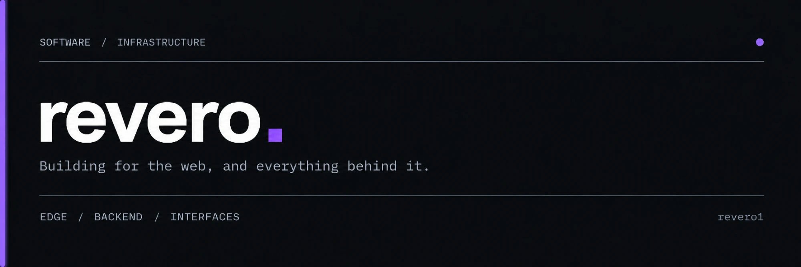

<p align="center">
  
</p>

<p align="center">
  
</p>

---

## `> whoami`

```ts
const revero = {
  role: "Middle Software Developer",
  focus: ["Web Applications", "Websites", "VK & Telegram Bots"],
  languages: ["TypeScript", "JavaScript", "PHP", "Python", "C#", "Rust", "Go"],
  frameworks: ["Next.js", "React"],
  motto: "Building for the web, and everything behind it.",
};
```

I design and build products end to end — from fast, polished interfaces to the backend services and infrastructure that keep them running.

- **Applications** — full-stack web apps with clean architecture and solid performance
- **Websites** — modern, responsive, SEO-friendly sites built with Next.js & React
- **Bots** — automation, integrations and chat bots for **VK** and **Telegram**
- **Backend** — APIs, services and tooling in TypeScript, Go, Rust, Python, PHP and C#

---

## `> stack`

### Languages

<p>
  
  
  
  
  
  
  
</p>

### Frameworks

<p>
  
  
</p>

### Platforms

<p>
  
  
</p>

---

## `> stats`

<p align="center">
  
  
</p>

<p align="center">
  
</p>

---

<p align="center">
  <code>EDGE / BACKEND / INTERFACES</code>
  <br />
  <sub>Open to collaboration — feel free to reach out.</sub>
</p>
